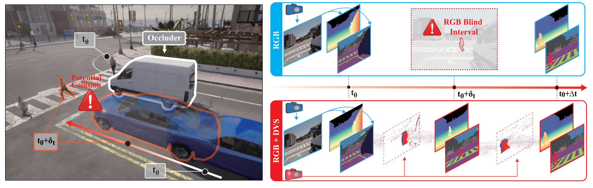
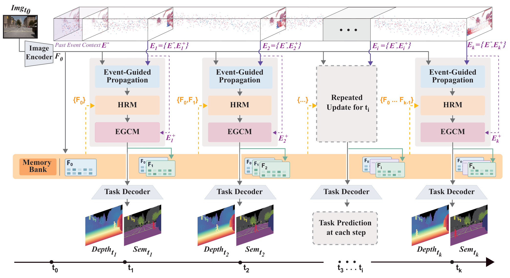
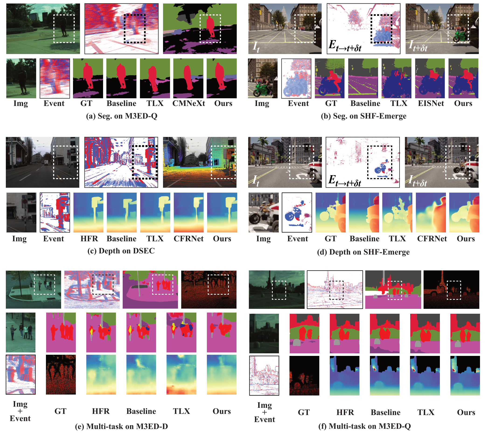

# LiFR v2

**Tao Wan**, **Xiaoshan Wu**, Yifei Yu, Bo Wang, Xiaoyang Lyu,  
Muxin Liu, Aoxuan Pan, Zhongrui Wang, Xiaojuan Qi

RGB–event feature propagation and completion for semantic segmentation,
monocular depth, and joint semantic/depth prediction.

**LiFR v2: Completion-Augmented Event Propagation for High-Frequency Dense Prediction**



Events provide evidence of scene changes between RGB observations, supporting
semantic and depth prediction before the next RGB frame.

## Method



An RGB keyframe provides anchor features. Event-guided propagation, HRM and
EGCM update these features for target-time predictions.

LiFR v1 uses its memory mechanism without completion. LiFR v2 uses SA+CA HRM followed
by ConvFusion EGCM and a learned gate. Segmentation and multi-task use four
attention layers with RoPE; depth uses one SA+CA block with a convolutional FFN.

## Qualitative results



Representative comparisons across the three tasks. Target-time RGB images and
HFR outputs serve as visual references.

## Installation

Use Python 3.10 and CUDA-enabled PyTorch. Install the requirements for your task:

```bash
pip install -r model/seg/requirements.txt
# Depth: pip install -r model/depth/requirements.txt
# Multi-task: pip install -r model/multi_task/requirements.txt
```

SoftSplat requires CuPy matching your CUDA runtime, such as `cupy-cuda12x` for
CUDA 12. Multi-task requires compatible MMCV, Mamba and causal-conv1d extensions;
use a separate environment for that task.

Run commands from the repository root:

```bash
export LIFR_DATA_ROOT=/path/to/prepared/datasets
export LIFR_WEIGHTS_ROOT="$PWD/weights"
export LIFR_OUTPUT_ROOT=/path/to/results
```

## Data

Depth and multi-task support DSEC, SHF-Emerge, M3ED-Falcon and M3ED-Spot;
segmentation also supports SHF-DSEC. The SHF-Emerge config directory is
`shf-emergy` for segmentation and `shf_emergy` for depth/multi-task; its data
root is `shf_emergy` for all tasks.

Prepared DSEC/SHF semantic data use:

```text
<dataset>/images/{train,val}/<sequence>/<index>.png
<dataset>/semantic/{train,val}/<sequence>/<index>.png
<dataset>/event_t0_t1/event_20/{train,val}/<sequence>/<index>.npy
```

SHF validation RGB also supports `images/val/val_semantic/`. M3ED uses `image/`
and supports the continuous `image/all`, `event_t0/all` layout. Event voxels
have 20 temporal channels. Use the dataset adapter's label mapping and ignore
ID 255. Depth and multi-task use `<dataset>/moge2/.train.txt` and `.val.txt`,
listing sample folders containing RGB, depth, intrinsics and `meta.json`.

`event[N]` spans RGB frames N to N+1; distillation uses RGB[N+1] as its teacher
input. Propagation starts from RGB[N] with a preceding context voxel. Intervals
are 50 ms for DSEC/SHF and 40 ms for M3ED; DSEC depth uses two 50 ms warps.
Keep images, labels and events spatially calibrated and timestamp-aligned.

## Training

| Stage / config name | Trainable components |
|---|---|
| `backbone` | RGB encoder and decoder |
| `lifr_v1` | E-RAFT, propagation, v1 memory and decoder |
| `distill` | Event encoder; RGB teacher frozen |
| `lifr_v2_hrm` | E-RAFT, propagation, HRM and decoder |
| `lifr_v2` | ConvFusion, gate and decoder |

For v1, train the backbone then `lifr_v1`. For v2, train the backbone,
run event distillation and HRM propagation, then train completion. Propagation
freezes the RGB encoder; completion freezes propagation and both encoders.
Gates train from the first completion update with
`g_eff = (1 - alpha) + alpha * sigmoid(logits)`. By default, `alpha = 0.01`
throughout training. Set `TRAIN.GATE_SCHEDULE: progressive` (seg),
`train.gate_schedule: "progressive"` (depth), or `gate_schedule: progressive`
(multi-task) for piecewise-linear interpolation through alpha values
`0.01 -> 0.5 -> 1` at 0%, 50% and 100% of training. Seg uses configured epochs;
depth and multi-task use updates (multi-task respects both epoch and iteration
limits). Fixed mode uses `GATE_ALPHA` / `gate_alpha`. Alpha is saved in the
checkpoint and reused for validation and inference; older checkpoints without
alpha retain their original gate behavior.

Use `--action train` with the selected stage config; use `--action distill`
with the distillation config. DSEC completion and distillation commands:

```bash
python run.py --task seg --action train --config configs/seg/dsec/lifr_v2.yaml --gpus 4
python run.py --task depth --action train --config configs/depth/dsec/lifr_v2.json --gpus 4
python run.py --task multi_task --action train --config configs/multi_task/dsec/lifr_v2.yaml --gpus 4

python run.py --task seg --action distill --config configs/seg/dsec/distill.yaml --gpus 4
python run.py --task depth --action distill --config configs/depth/dsec/distill.json --gpus 4
python run.py --task multi_task --action distill --config configs/multi_task/dsec/distill.yaml --gpus 4
```

Before each stage, set its initializer paths. Templates use
`weights/<task>/backbone_<dataset>.pt`, `hrm_<dataset>.pt` and
`event_encoder_<dataset>.pt`; dataset hyphens become underscores in filenames.
Upstream initializers are `seg/mit_b2.pth`, `seg/mit_b0.pth`,
`depth/moge2_vits.pt`, and `pretrained/mmseg_swin_tiny_patch4_window7_224.pth`
under the weights root. Depth training validates every 1,000 updates.

## Evaluation

```bash
python run.py --task seg --action eval --config configs/seg/dsec/lifr_v2.yaml --weights weights/seg/lifr2_dsec.pt
python run.py --task depth --action eval --config configs/depth/dsec/lifr_v2_eval.json --weights weights/depth/lifr2_dsec.pt --gpus 4
python run.py --task multi_task --action eval --config configs/multi_task/dsec/lifr_v2.yaml --weights /path/to/joint_model.pt --gpus 4
```

SHF-Emerge depth is evaluated over 1–10 m; other datasets use their configured
validity ranges. MoGe resolution settings select 1,200–3,600 tokens.
For single-sample depth inference arguments, run:

```bash
python run.py --task depth --action infer --weights weights/depth/lifr2_dsec.pt -- --help
```

## Pretrained weights

Download the [DSEC checkpoints](https://github.com/TaoWan0610/LiFR-v2/releases/tag/v2.0-weights)
and place them at the paths below:

| Component | Download | Local path |
|---|---|---|
| Semantic LiFR v2 | [Checkpoint](https://github.com/TaoWan0610/LiFR-v2/releases/download/v2.0-weights/seg_lifr2_dsec.pt) | `weights/seg/lifr2_dsec.pt` |
| Semantic RGB backbone | [Checkpoint](https://github.com/TaoWan0610/LiFR-v2/releases/download/v2.0-weights/seg_backbone_dsec.pt) | `weights/seg/backbone_dsec.pt` |
| Depth LiFR v2 | [Checkpoint](https://github.com/TaoWan0610/LiFR-v2/releases/download/v2.0-weights/depth_lifr2_dsec.pt) | `weights/depth/lifr2_dsec.pt` |
| Depth RGB backbone | [Checkpoint](https://github.com/TaoWan0610/LiFR-v2/releases/download/v2.0-weights/depth_backbone_dsec.pt) | `weights/depth/backbone_dsec.pt` |
| E-RAFT | [Checkpoint](https://github.com/TaoWan0610/LiFR-v2/releases/download/v2.0-weights/eraft_dsec.tar) | `weights/flownet/dsec.tar` |

See the [release metadata](https://github.com/TaoWan0610/LiFR-v2/releases/download/v2.0-weights/manifest.json)
for architectures and metric provenance.

Data, checkpoint binaries and generated outputs are excluded from source control.
Original LiFR contributions use the [MIT license](LICENSE). Third-party code
retains its original terms; see the [bundled licenses](docs/third_party/).
